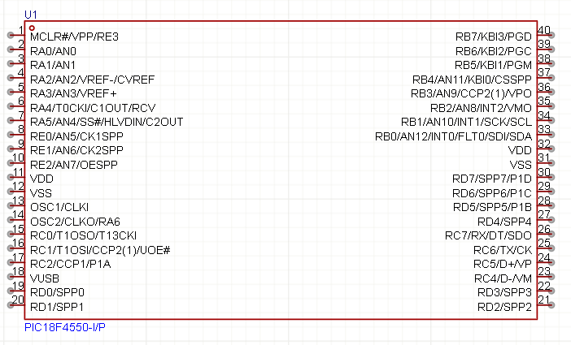

# 🧠 PIC18F4550 – Microcontrolador



## 📘 Descrição geral

O **PIC18F4550** é um microcontrolador de **8 bits** da família **PIC18**, fabricado pela **Microchip**.  
É um dos modelos mais populares para projetos didáticos e aplicações embarcadas que exigem **interface USB**, **ADC**, **PWM**, **temporizadores**, **interrupções** e **memória Flash regravável**.

Projetos como a **Central de Alarme**, **sistemas de automação**, **instrumentação** e **controle digital** utilizam este chip por sua facilidade de programação e versatilidade.

---

## ⚙️ Especificações técnicas principais

| Recurso | Descrição |
|----------|------------|
| **Arquitetura** | Harvard, 8 bits, pipeline de 2 estágios |
| **Frequência máxima** | 48 MHz (com PLL de 4× e cristal de 8 MHz) |
| **Memória Flash** | 32 KB |
| **RAM (dados)** | 2 KB |
| **EEPROM** | 256 bytes |
| **Portas I/O digitais** | Até 35 pinos configuráveis |
| **Conversores A/D** | 10 bits, até 13 canais |
| **Temporizadores** | Timer0, Timer1, Timer2, Timer3 |
| **PWM / CCP** | 2 módulos CCP, 1 módulo ECCP |
| **Comunicações** | UART, SPI, I²C, USB 2.0 (Full-Speed) |
| **Interrupções** | Externas, por periférico e por timer |
| **Tensão de operação** | 4,2 V – 5,5 V |
| **Pacote físico** | DIP-40, TQFP, QFN |

---

## ⚡ Pinos e Funções Principais

### 🔋 Alimentação
- **VDD**: +5 V  
- **VSS**: GND  
- **VUSB**: pino de referência do módulo USB (precisa de capacitor de 470 nF para GND)

### 🔄 Oscilador
- **OSC1/CLKI (pino 13)**  
- **OSC2/CLKO (pino 14)**  
  > Utiliza cristal externo (ex.: 8 MHz) + capacitores de 27 pF.

### 🔁 Reset
- **MCLR (pino 1)**: ativo em nível baixo, com resistor **10 kΩ** de pull-up para +5 V.  
  Pode incluir capacitor de 1 µF para reset automático ao ligar.

### 🧩 Portas de I/O
| Porta | Função principal | Funções alternativas |
|--------|------------------|----------------------|
| **PORTA** | Entradas analógicas (AN0–AN4) | Timer0/1, comparadores |
| **PORTB** | I/O digitais e interrupções externas | INT0, INT1, INT2, KBI |
| **PORTC** | Saídas para displays e comunicação | TX/RX (UART), SCK/SDA (I²C), CCP/PWM |
| **PORTD** | Dados paralelos (Display LCD, 7 segmentos) | PSP (Parallel Slave Port) |
| **PORTE** | Entradas analógicas adicionais | Controle de LCD e teclado |

---

## 🧮 Conexões básicas recomendadas

| Função | Componentes externos |
|--------|-----------------------|
| **Clock** | Cristal de 8 MHz + 2× 27 pF |
| **Reset (MCLR)** | 10 kΩ pull-up + capacitor 1 µF para GND |
| **Desacoplamento** | 100 nF por VDD (colado ao chip) + 10–100 µF próximo à alimentação |
| **USB** | Capacitor 470 nF em VUSB para GND |
| **Alimentação** | 5 V regulada estável |

---

## 💡 Observações de firmware (XC8)

- Configure pinos de entrada/saída via **TRISx**.
- Utilize **LATx** para escrever nas portas (evita *read-modify-write*).
- Configure os **fuses** corretamente:
  ```c
  #pragma config FOSC = HS     // Oscilador externo
  #pragma config WDT = OFF     // Watchdog Timer desativado
  #pragma config LVP = OFF     // Programação em baixa tensão off
  #pragma config PBADEN = OFF  // PORTA digital ao iniciar
